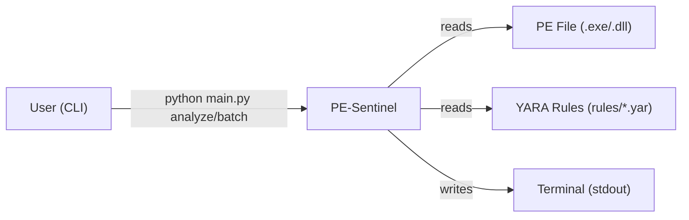
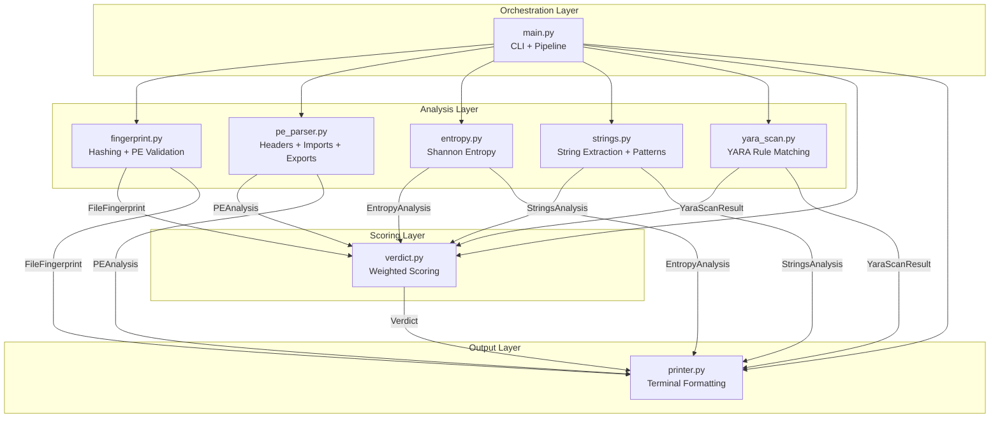
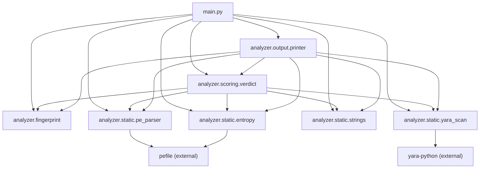

# 04 — Architecture

## Overview

PE-Sentinel is a single-process, synchronous, pipeline-based CLI application.
It has no database, no network communication, no background jobs, and no
persistent state. Each invocation reads files from disk, processes them through
a fixed sequence of analysis stages, and prints results to stdout.

## Layers

The application has four layers, organized from bottom to top:

1. **Analysis Layer** (`analyzer/static/`, `analyzer/fingerprint.py`) — reads
   PE files and extracts raw signals. Each module is independent and produces
   its own dataclass result.
2. **Scoring Layer** (`analyzer/scoring/verdict.py`) — consumes all analysis
   results and applies a weighted scoring algorithm to produce a single verdict.
3. **Output Layer** (`analyzer/output/printer.py`) — formats results for
   terminal display. This is the only module that calls `print()`.
4. **Orchestration Layer** (`main.py`) — parses CLI arguments and wires the
   other layers together in the correct order.

## System Context Diagram

The system has no external service dependencies. It reads files from the local
filesystem and writes formatted text to stdout.

## High-Level Architecture Diagram

Data flows downward from the orchestration layer through analysis, into scoring,
and finally into output. Each analysis module produces an independent dataclass
that is consumed by both the scoring engine and the printer.

## Module Dependency Graph

This diagram shows import dependencies. The analysis modules (`fingerprint`,
`pe_parser`, `entropy`, `strings`, `yara_scan`) are leaf nodes with no
cross-dependencies between them. Both `verdict` and `printer` import all
analysis modules to reference their dataclass types.

## Component Responsibilities

| Component | File | Responsibility | Inputs | Outputs |
|-----------|------|---------------|--------|---------|
| CLI | `main.py` | Argument parsing, pipeline orchestration, error handling | CLI args | Exit code |
| Fingerprint | `analyzer/fingerprint.py` | File hashing, PE magic validation | File path | `FileFingerprint` |
| PE Parser | `analyzer/static/pe_parser.py` | Header parsing, import/export analysis, suspicious API detection | File path | `PEAnalysis` |
| Entropy | `analyzer/static/entropy.py` | Per-section Shannon entropy, packing detection | File path, section info | `EntropyAnalysis` |
| Strings | `analyzer/static/strings.py` | String extraction, regex pattern matching | File path | `StringsAnalysis` |
| YARA Scanner | `analyzer/static/yara_scan.py` | Rule discovery, compilation, scanning | File path, rules dir | `YaraScanResult` |
| Verdict | `analyzer/scoring/verdict.py` | Weighted scoring, band assignment | All analysis results | `Verdict` |
| Printer | `analyzer/output/printer.py` | Terminal output formatting | All analysis results + Verdict | stdout text |

## Boundaries

- **Process boundary**: the entire application runs in a single Python process.
- **I/O boundary**: modules read from the filesystem only. No network, no IPC.
- **Data boundary**: all inter-module communication is via typed dataclasses.
  No global state, no shared mutable objects.

## Design Patterns

| Pattern | Where | Why |
|---------|-------|-----|
| Pipeline | `main.py:36-71` (`_analyze_single_file`) | The analysis is a fixed sequence of stages. Each stage is independent and produces an immutable result. A pipeline makes the order explicit and each stage testable in isolation. |
| Data Transfer Object (DTO) | All `@dataclass` types | Each analysis module returns a plain data container. This decouples analysis logic from output formatting and scoring. The DTOs carry no behavior. |
| Facade | `main.py:36` (`_analyze_single_file`) | Hides the complexity of calling five analysis modules behind a single function call. |
| Strategy (implicit) | `analyzer/static/pe_parser.py:33-112` (`SUSPICIOUS_IMPORTS`, `SUSPICIOUS_COMBOS`) | Suspicious API detection is data-driven. The curated dictionary acts as a configurable detection strategy that can be extended without modifying logic. |
| Graceful degradation | `analyzer/static/yara_scan.py:22-28` | YARA scanning is optional. If yara-python fails to import, the module returns an empty result instead of crashing. |
| Separation of concerns | `analyzer/output/printer.py:4` | "This module is the ONLY place that calls print()." Analysis modules never produce formatted output. |
