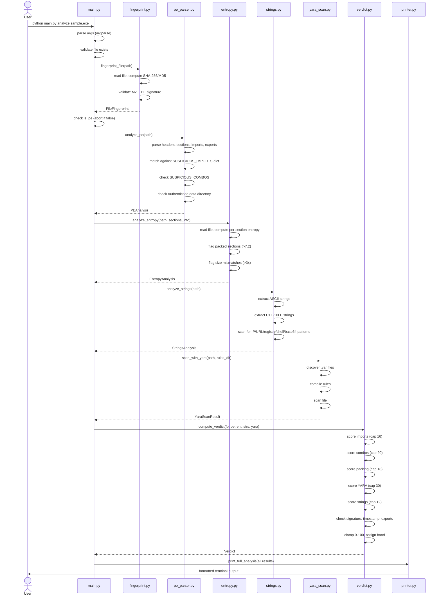
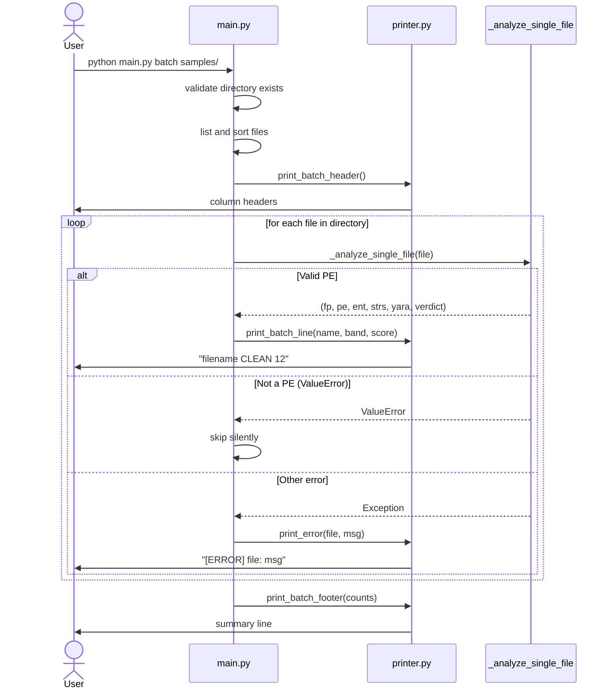
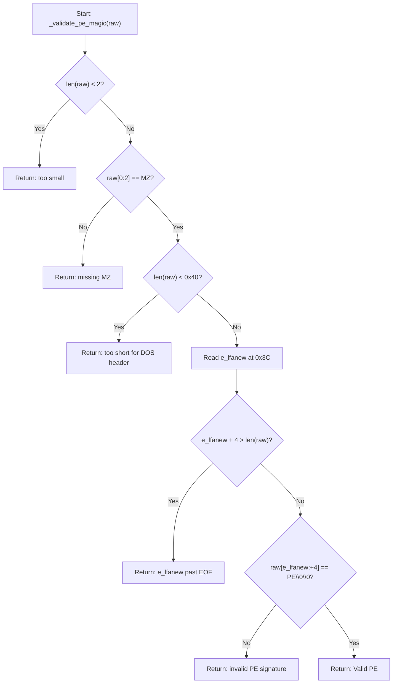
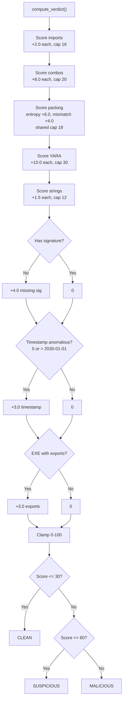

# 05 — End-to-End Flows

## Flow 1: Single File Analysis (`python main.py analyze <file>`)

### Trace

1. `main.py:216-217` — `__main__` guard calls `main()`.
2. `main.py:158-213` — `main()` creates `argparse.ArgumentParser`, defines `analyze` and `batch` subcommands, parses args.
3. `main.py:207-208` — Dispatches to `cmd_analyze(args)`.
4. `main.py:74-98` — `cmd_analyze()` validates file exists, calls `_analyze_single_file()`.
5. `main.py:36-71` — `_analyze_single_file()` runs the pipeline:
   - `main.py:43` — Step 1: `fingerprint_file(file_path)` in `analyzer/fingerprint.py:100-124`.
   - `main.py:45-48` — Checks `fp.is_pe`; raises `ValueError` if not a PE.
   - `main.py:51` — Step 2: `analyze_pe(file_path)` in `analyzer/static/pe_parser.py:214-344`.
   - `main.py:56-60` — Step 3: Builds `sections_info` from PE results; calls `analyze_entropy(file_path, sections_info)` in `analyzer/static/entropy.py:95-191`.
   - `main.py:63` — Step 4: `analyze_strings(file_path)` in `analyzer/static/strings.py:176-236`.
   - `main.py:66` — Step 5: `scan_with_yara(file_path, RULES_DIR)` in `analyzer/static/yara_scan.py:80-185`.
   - `main.py:69` — Step 6: `compute_verdict(fp, pe, ent, strs, yara)` in `analyzer/scoring/verdict.py:130-312`.
6. `main.py:97` — `print_full_analysis(fp, pe, ent, strs, yara_res, verdict, verbose)` in `analyzer/output/printer.py:67-240`.
7. `main.py:98` — Returns exit code 0.

### Sequence Diagram

## Flow 2: Batch Analysis (`python main.py batch <folder>`)

### Trace

1. `main.py:216-217` — `__main__` guard calls `main()`.
2. `main.py:158-213` — Parses args, dispatches to `cmd_batch(args)` at `main.py:209-210`.
3. `main.py:101-155` — `cmd_batch()`:
   - `main.py:109-111` — Validates directory exists.
   - `main.py:115-119` — Lists and sorts all files in the directory (non-recursive, `main.py:113-114`).
   - `main.py:125` — Calls `print_batch_header()` (`printer.py:247-250`).
   - `main.py:130-143` — Iterates over files:
     - Calls `_analyze_single_file()` for each (same pipeline as Flow 1).
     - On success: calls `print_batch_line()` (`printer.py:253-257`), increments band counter.
     - On `ValueError`: silently skips (not a PE, `main.py:138-140`).
     - On other `Exception`: calls `print_error()` (`printer.py:268-270`), increments error counter.
   - `main.py:148-153` — Calls `print_batch_footer()` (`printer.py:260-265`).
4. `main.py:155` — Returns 1 if errors occurred, 0 otherwise.

### Sequence Diagram

## Flow 3: PE Validation (within fingerprint_file)

### Trace

1. `fingerprint.py:100-124` — `fingerprint_file()`:
   - `fingerprint.py:107` — Normalizes path with `os.path.abspath()`.
   - `fingerprint.py:110-111` — Opens file in binary mode, reads entire contents.
   - `fingerprint.py:113` — Calls `_compute_hashes(raw)` (`fingerprint.py:38-47`): computes SHA-256 and MD5 in a single pass.
   - `fingerprint.py:114` — Calls `_validate_pe_magic(raw)` (`fingerprint.py:50-97`).
2. `fingerprint.py:50-97` — `_validate_pe_magic()`:
   - `fingerprint.py:63-64` — Checks file length >= 2 bytes.
   - `fingerprint.py:67-71` — Checks bytes 0-1 are `MZ` (0x4D5A).
   - `fingerprint.py:75-76` — Checks file length >= 0x40 (64 bytes) for complete DOS header.
   - `fingerprint.py:79` — Reads `e_lfanew` (4-byte LE uint at offset 0x3C).
   - `fingerprint.py:83-87` — Validates `e_lfanew` points within file bounds.
   - `fingerprint.py:90-95` — Reads 4 bytes at `e_lfanew`, checks for `PE\0\0`.

### Flowchart

## Flow 4: Scoring Decision Logic

### Trace

1. `verdict.py:130-312` — `compute_verdict()`:
   - Lines 161-173: Iterates suspicious imports, adds 2.0 points each up to cap of 16.0.
   - Lines 176-189: Iterates import combos, adds 8.0 points each up to cap of 20.0.
   - Lines 192-218: Iterates packed and mismatched sections, adds 6.0 and 4.0 points respectively up to shared cap of 18.0.
   - Lines 221-234: Iterates YARA matches, adds 10.0 points each up to cap of 30.0.
   - Lines 237-253: Iterates string matches, adds 1.5 points each up to cap of 12.0.
   - Lines 256-265: Adds 4.0 for missing Authenticode signature.
   - Lines 268-280: Adds 3.0 for anomalous timestamp (epoch 0 or > 2030).
   - Lines 283-294: Adds 3.0 for `.exe` with export table.
   - Line 297: Clamps to 0-100.
   - Lines 300-305: Assigns band (0-30=CLEAN, 31-60=SUSPICIOUS, 61-100=MALICIOUS).

### Flowchart

