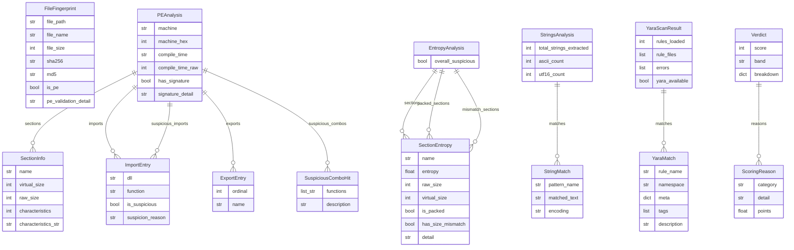

# 06 — Data Model

## Overview

PE-Sentinel has no database. All data is represented as Python dataclasses that
are created during a single analysis run and discarded when the process exits.
These dataclasses serve as the data transfer objects between modules.

## ER Diagram

## Entity Details

### FileFingerprint (`analyzer/fingerprint.py:22-36`)

The first dataclass produced in the pipeline. Contains file identity and PE
validation status.

| Field | Type | Description | Source |
|-------|------|-------------|--------|
| `file_path` | `str` | Absolute path to the analyzed file | `fingerprint.py:29` |
| `file_name` | `str` | Basename (e.g. "malware.exe") | `fingerprint.py:30` |
| `file_size` | `int` | Size in bytes | `fingerprint.py:31` |
| `sha256` | `str` | Hex-encoded SHA-256 hash (64 chars) | `fingerprint.py:32` |
| `md5` | `str` | Hex-encoded MD5 hash (32 chars) | `fingerprint.py:33` |
| `is_pe` | `bool` | True if MZ + PE\0\0 checks pass | `fingerprint.py:34` |
| `pe_validation_detail` | `str` | Human-readable validation result | `fingerprint.py:35` |

Created by: `fingerprint_file()` (`fingerprint.py:100`).
Consumed by: `compute_verdict()` (`verdict.py:131`), `print_full_analysis()` (`printer.py:68`).

### PEAnalysis (`analyzer/static/pe_parser.py:152-168`)

Contains all information extracted from the PE header structure.

| Field | Type | Description | Source |
|-------|------|-------------|--------|
| `machine` | `str` | Architecture (e.g. "AMD64", "I386") | `pe_parser.py:155` |
| `machine_hex` | `int` | Raw machine field value | `pe_parser.py:156` |
| `compile_time` | `str` | Formatted timestamp string | `pe_parser.py:157` |
| `compile_time_raw` | `int` | Raw Unix timestamp from COFF header | `pe_parser.py:158` |
| `sections` | `list[SectionInfo]` | All sections in the PE section table | `pe_parser.py:160` |
| `imports` | `list[ImportEntry]` | All imported functions | `pe_parser.py:161` |
| `exports` | `list[ExportEntry]` | All exported symbols | `pe_parser.py:162` |
| `suspicious_imports` | `list[ImportEntry]` | Subset of imports flagged as suspicious | `pe_parser.py:164` |
| `suspicious_combos` | `list[SuspiciousComboHit]` | Matched dangerous import combinations | `pe_parser.py:165` |
| `has_signature` | `bool` | Authenticode data directory present | `pe_parser.py:167` |
| `signature_detail` | `str` | Explanation of signature check | `pe_parser.py:168` |

Created by: `analyze_pe()` (`pe_parser.py:214`).
Consumed by: `compute_verdict()` (`verdict.py:133`), `analyze_entropy()` (indirectly, sections passed via `main.py:56-60`), `print_full_analysis()` (`printer.py:69`).

### SectionInfo (`analyzer/static/pe_parser.py:119-126`)

One row of the PE section table.

| Field | Type | Description | Source |
|-------|------|-------------|--------|
| `name` | `str` | Section name (e.g. ".text") | `pe_parser.py:122` |
| `virtual_size` | `int` | Size when loaded into memory | `pe_parser.py:123` |
| `raw_size` | `int` | Size on disk | `pe_parser.py:124` |
| `characteristics` | `int` | Raw flags bitfield | `pe_parser.py:125` |
| `characteristics_str` | `str` | Human-readable flags | `pe_parser.py:126` |

### ImportEntry (`analyzer/static/pe_parser.py:129-135`)

One imported function from a DLL.

| Field | Type | Description | Source |
|-------|------|-------------|--------|
| `dll` | `str` | DLL name (e.g. "KERNEL32.dll") | `pe_parser.py:132` |
| `function` | `str` | Function name (e.g. "VirtualAlloc") | `pe_parser.py:133` |
| `is_suspicious` | `bool` | True if in curated suspicious list | `pe_parser.py:134` |
| `suspicion_reason` | `str` | Why flagged (empty if not suspicious) | `pe_parser.py:135` |

### ExportEntry (`analyzer/static/pe_parser.py:138-142`)

| Field | Type | Description | Source |
|-------|------|-------------|--------|
| `ordinal` | `int` | Export ordinal number | `pe_parser.py:141` |
| `name` | `Optional[str]` | Symbol name (None for ordinal-only) | `pe_parser.py:142` |

### SuspiciousComboHit (`analyzer/static/pe_parser.py:145-149`)

| Field | Type | Description | Source |
|-------|------|-------------|--------|
| `functions` | `list[str]` | Functions that matched the combo | `pe_parser.py:148` |
| `description` | `str` | Why this combination is suspicious | `pe_parser.py:149` |

### SectionEntropy (`analyzer/static/entropy.py:44-53`)

| Field | Type | Description | Source |
|-------|------|-------------|--------|
| `name` | `str` | Section name | `entropy.py:47` |
| `entropy` | `float` | Shannon entropy (0.0-8.0) | `entropy.py:48` |
| `raw_size` | `int` | Size on disk | `entropy.py:49` |
| `virtual_size` | `int` | Size in memory | `entropy.py:50` |
| `is_packed` | `bool` | True if entropy > 7.2 | `entropy.py:51` |
| `has_size_mismatch` | `bool` | True if vsize/rsize >= 3.0 | `entropy.py:52` |
| `detail` | `str` | Human-readable explanation | `entropy.py:53` |

### EntropyAnalysis (`analyzer/static/entropy.py:56-62`)

| Field | Type | Description | Source |
|-------|------|-------------|--------|
| `sections` | `list[SectionEntropy]` | All section results | `entropy.py:59` |
| `packed_sections` | `list[SectionEntropy]` | Subset flagged as packed | `entropy.py:60` |
| `mismatch_sections` | `list[SectionEntropy]` | Subset with size mismatches | `entropy.py:61` |
| `overall_suspicious` | `bool` | True if any section flagged | `entropy.py:62` |

### StringMatch (`analyzer/static/strings.py:117-122`)

| Field | Type | Description | Source |
|-------|------|-------------|--------|
| `pattern_name` | `str` | Pattern category (e.g. "IPv4 Address") | `strings.py:120` |
| `matched_text` | `str` | The actual matched text | `strings.py:121` |
| `encoding` | `str` | "ascii" or "utf-16le" | `strings.py:122` |

### StringsAnalysis (`analyzer/static/strings.py:125-132`)

| Field | Type | Description | Source |
|-------|------|-------------|--------|
| `total_strings_extracted` | `int` | Total strings found | `strings.py:128` |
| `ascii_count` | `int` | ASCII strings found | `strings.py:129` |
| `utf16_count` | `int` | UTF-16LE strings found | `strings.py:130` |
| `matches` | `list[StringMatch]` | Suspicious pattern hits | `strings.py:131` |
| `match_summary` | `dict[str, int]` | Pattern name to hit count | `strings.py:132` |

### YaraMatch (`analyzer/static/yara_scan.py:35-42`)

| Field | Type | Description | Source |
|-------|------|-------------|--------|
| `rule_name` | `str` | Rule identifier | `yara_scan.py:38` |
| `namespace` | `str` | Namespace (usually filename) | `yara_scan.py:39` |
| `meta` | `dict[str, str]` | Rule metadata fields | `yara_scan.py:40` |
| `tags` | `list[str]` | Rule tags | `yara_scan.py:41` |
| `description` | `str` | From meta["description"] | `yara_scan.py:42` |

### YaraScanResult (`analyzer/static/yara_scan.py:45-52`)

| Field | Type | Description | Source |
|-------|------|-------------|--------|
| `rules_loaded` | `int` | Number of compiled rules | `yara_scan.py:48` |
| `rule_files` | `list[str]` | Paths to loaded rule files | `yara_scan.py:49` |
| `matches` | `list[YaraMatch]` | Rules that matched | `yara_scan.py:50` |
| `errors` | `list[str]` | Compilation/scan errors | `yara_scan.py:51` |
| `yara_available` | `bool` | Whether yara-python imported | `yara_scan.py:52` |

### ScoringReason (`analyzer/scoring/verdict.py:109-114`)

| Field | Type | Description | Source |
|-------|------|-------------|--------|
| `category` | `str` | Finding category (e.g. "YARA Rule") | `verdict.py:112` |
| `detail` | `str` | Human-readable finding | `verdict.py:113` |
| `points` | `float` | Points contributed | `verdict.py:114` |

### Verdict (`analyzer/scoring/verdict.py:117-123`)

| Field | Type | Description | Source |
|-------|------|-------------|--------|
| `score` | `int` | Final score (0-100, clamped) | `verdict.py:120` |
| `band` | `str` | "CLEAN", "SUSPICIOUS", or "MALICIOUS" | `verdict.py:121` |
| `reasons` | `list[ScoringReason]` | All contributing findings | `verdict.py:122` |
| `breakdown` | `dict[str, float]` | Category to total points | `verdict.py:123` |

## Data Lifecycle

All data is ephemeral. The lifecycle for a single analysis run:

1. **Create**: File is read from disk. `fingerprint_file()` produces `FileFingerprint`.
2. **Read**: `main.py` checks `is_pe`. If false, the pipeline stops.
3. **Create**: Four analysis modules each read the file and produce their respective dataclasses.
4. **Read**: `compute_verdict()` reads all five dataclasses and produces `Verdict`.
5. **Read**: `print_full_analysis()` reads all six dataclasses and writes formatted text to stdout.
6. **Discard**: All dataclasses go out of scope when the function returns.

There is no update or delete. Data flows in one direction: file to dataclass to output.
